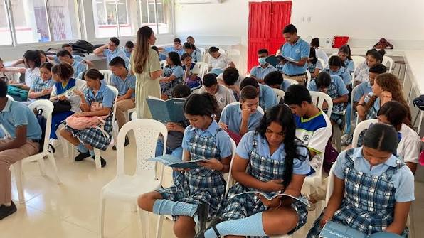

# Sistema de Reservas de Aulas

<div align="center">
  
</div>

Proyecto de grado desarrollado para optimizar la gestión de reservas de aulas, horarios, usuarios y procesos académicos de una institución educativa. La solución permite coordinar el uso de espacios físicos de forma ordenada, segura y eficiente, evitando conflictos de programación y mejorando la administración docente.

## ¿Qué es este proyecto?

Este sistema está pensado para respaldar la administración interna de la institución, centralizando en una sola plataforma la gestión de:

- aulas y salas disponibles,
- horarios docentes,
- solicitudes de reserva,
- usuarios del sistema con roles definidos,
- validaciones académicas y administrativas,
- reportes y seguimiento del uso de espacios.

El objetivo es transformar un proceso tradicional y propenso a errores en una solución digital, fácil de usar, con control por perfiles y con trazabilidad de acciones.

## ¿Para quién está pensado?

Está orientado a:

- la institución educativa,
- la dirección o coordinación académica,
- docentes,
- personal administrativo,
- usuarios con rol de administración y supervisión.

## Propósito académico

Este proyecto se presenta como una solución tecnológica desarrollada dentro de un contexto de proyecto de grado. Su finalidad es demostrar la capacidad de diseñar, implementar y consolidar un sistema funcional para resolver un problema real del entorno institucional: la organización del uso de aulas y la administración de horarios.

No es un proyecto ficticio ni un prototipo sin contexto. Está enfocado en una necesidad real de la operación académica diaria.

---

## Funcionalidades principales

- gestión de aulas y disponibilidad,
- registro de usuarios por rol,
- autenticación para acceso seguro,
- creación y validación de reservas,
- revisión de horarios y conflictos,
- panel administrativo con métricas clave,
- seguimiento de estados de solicitudes,
- gestión de permisos por perfil,
- arquitectura preparada para entorno institucional y despliegue web.

## Roles del sistema

### Superadministrador
Tiene acceso completo a la gestión del sistema, incluyendo usuarios, aulas, reservas, horarios y reportes.

### Profesor
Puede consultar y gestionar sus reservass y visualizar la disponibilidad según su actividad académica.

## Stack tecnológico

El proyecto combina una solución web institucional con una migración moderna hacia una plataforma en Vercel/Next.js:

- PHP 8.x
- MySQL / MariaDB
- PDO para acceso a base de datos
- JavaScript y Bootstrap
- Next.js 16 + React
- Supabase para persistencia y autenticación
- Arquitectura modular para separar lógica, vista y configuración

## Visión del sistema

La aplicación busca consolidar la administración académica en un entorno único, accesible y confiable. Con esto se mejora:

- la organización del uso de aulas,
- la visibilidad operativa para el personal administrativo,
- la planificación de horarios docentes,
- la reducción de conflictos y duplicidades,
- la trazabilidad del uso de los espacios institucionales.

---

## Capturas del proyecto

<div align="center">
  
  
</div>

---

## Estructura del repositorio

```text
.
├── admin/
├── aulas/
├── config/
├── css/
├── database/
├── docs/
├── horarios/
├── img/
├── js/
├── login/
├── migracion-vercel/
├── reportes/
├── reservas/
├── supabase/
├── usuarios/
├── index.php
├── dashboard.php
├── README.md
├── package.json
└── .env.local
```

## Cómo funciona

1. El usuario ingresa con sus credenciales.
2. El sistema identifica su rol.
3. Según el perfil, el usuario accede a la vista correspondiente.
4. El sistema valida si el aula, horario y la solicitud son coherentes con la programación académica.
5. La reserva queda registrada y queda disponible para consulta o administración.

## Requisitos

- PHP 8 o superior
- MySQL / MariaDB
- Navegador moderno
- Entorno local o servidor institucional
- Variables de entorno configuradas para Supabase

## Configuración

El proyecto usa variables de entorno para la conexión con Supabase. Estas deben configurarse correctamente en el entorno de ejecución, especialmente en la app de migración Vercel/Next.js.

Ejemplo:

```env
NEXT_PUBLIC_SUPABASE_URL=tu_url_del_proyecto
NEXT_PUBLIC_SUPABASE_ANON_KEY=tu_anon_key
```

## Estado del proyecto

El sistema está en una fase de consolidación como solución funcional para uso institucional. La versión actual incluye:

- autenticación por roles,
- gestión de reservas,
- administración de aulas y profesores,
- panel administrativo,
- migración modernizada a Next.js,
- preparación para despliegue en entorno web.

## Objetivo institucional

El proyecto intenta ofrecer una herramienta tecnológica que permita al personal académico y administrativo organizar mejor la disponibilidad de espacios, reducir errores manuales y fortalecer la operativa de la institución.

Se trata de una solución útil, útil para la realidad educativa, y con perspectiva de continuidad y mejora en etapas futuras.

---

## Conclusión

Este sistema representa un proyecto de grado enfocado en resolver un problema real de la institución: la gestión ordenada y segura del uso de aulas y horarios. Su valor no solo está en la parte técnica, sino también en la utilidad institucional que aporta a la organización académica, la administración y la experiencia docente.

El repositorio reúne la base del proyecto original y la evolución hacia una versión moderna y preparada para entornos web y despliegue institucional.

---

## Licencia y uso

Este proyecto está desarrollado con fines académicos y de gestión institucional. Su uso debe ajustarse a la política interna de la institución y a los objetivos del proyecto de grado en el que se enmarca.

---

## Nota final

El objetivo principal de este repositorio es dejar documentado, claro y profesional el alcance del proyecto para que cualquier persona que lo revise pueda entender de inmediato qué es, para quién está hecho, para qué sirve y cómo encaja como solución tecnológica académica.
