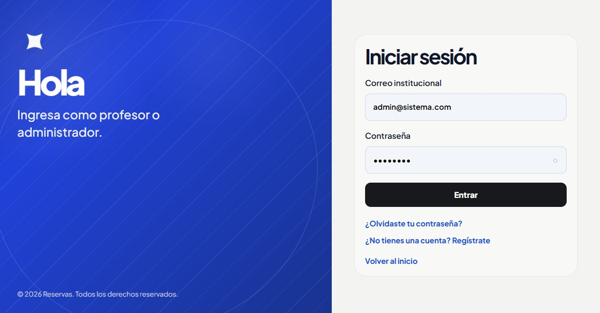
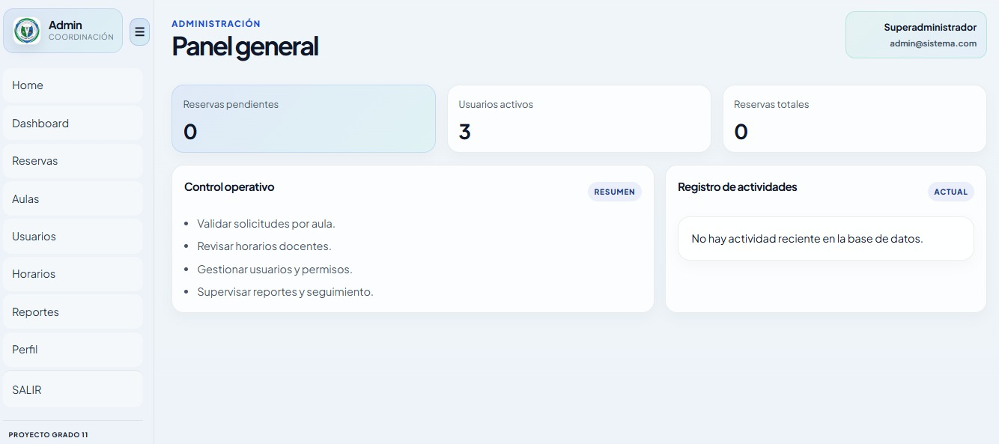
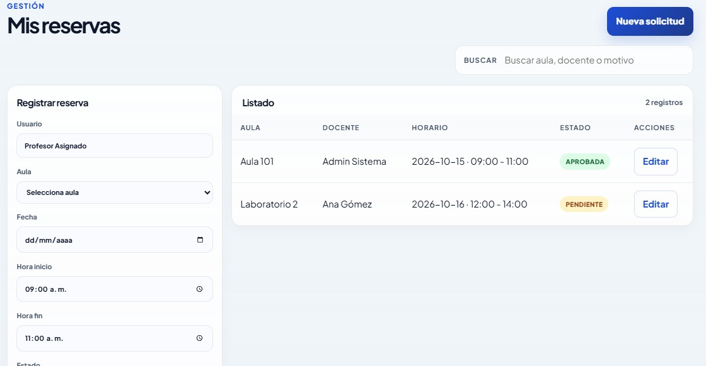

# Sistema de reservas de aulas

Proyecto académico para gestionar aulas, horarios, usuarios y solicitudes de reserva en una institución educativa.

## Problema que resuelve

Centraliza la disponibilidad de espacios y reduce conflictos de horario mediante roles, validaciones y seguimiento del estado de las solicitudes.

## Demo

[Abrir la aplicación](https://sistema-reservas-aulas-fkhm.vercel.app/login)

La demo es un entorno de presentación. No introduzcas información personal ni credenciales reales.

## Funcionalidades

- Autenticación y autorización por roles.
- Gestión de usuarios, aulas y horarios.
- Creación y validación de reservas.
- Seguimiento de solicitudes.
- Paneles diferenciados para administración y docentes.

## Implementaciones

El repositorio contiene dos partes relacionadas:

- `*.php`: implementación académica con PHP y MySQL.
- `migracion-vercel/`: migración web con Next.js y Supabase.

## Tecnologías

PHP · MySQL · JavaScript · React · Next.js · Supabase

## Capturas

<p align="center">
  
</p>

<p align="center">
  
</p>

<p align="center">
  
</p>

## Ejecución local

### Implementación PHP

1. Instala PHP, MySQL o MariaDB y un servidor web local.
2. Crea una base de datos e importa `database/db_reservas_aulas.sql`.
3. Configura la conexión en `config/conexion.php`.
4. Sirve el directorio desde tu servidor PHP local.

### Migración Next.js

```bash
cd migracion-vercel
npm install
npm run dev
```

Configura las variables de entorno en un archivo local no versionado:

```env
NEXT_PUBLIC_SUPABASE_URL=https://tu-proyecto.supabase.co
NEXT_PUBLIC_SUPABASE_ANON_KEY=tu_clave_local
```

Nunca publiques credenciales reales ni datos institucionales.

## Pruebas

La migración incluye pruebas para reglas académicas en `migracion-vercel/lib/academic-rules.test.js`. Ejecuta los scripts definidos en `migracion-vercel/package.json`.

## Estado

Prototipo académico funcional. La implementación PHP y la migración Next.js pueden evolucionar de forma independiente.
