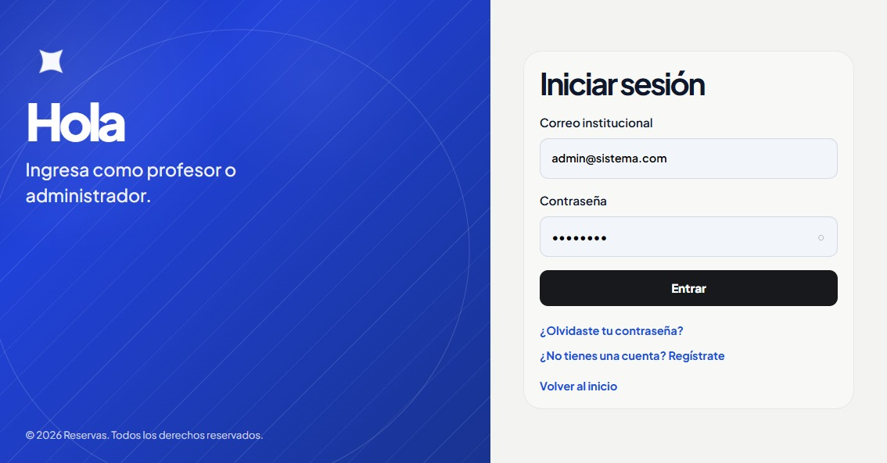
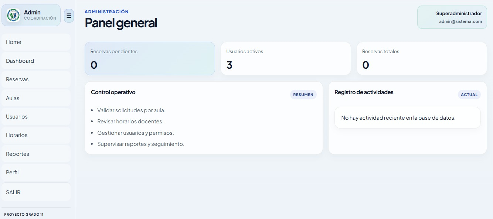
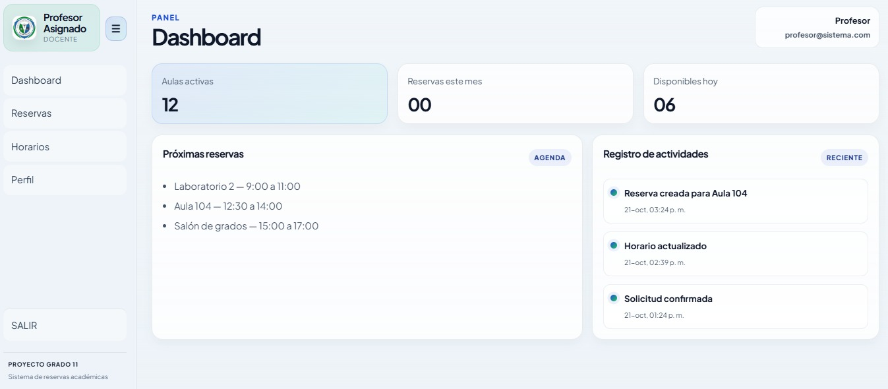
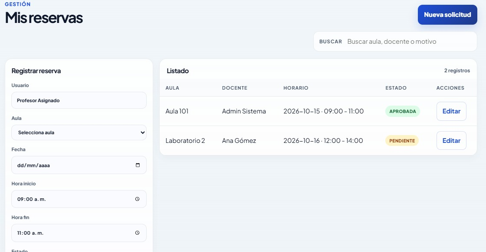

# Sistema de reservas de aulas

> Proyecto académico orientado a la gestión institucional de reservas, horarios, usuarios y control operativo de aulas.

<p align="center">
  
  
  
  
</p>

## 🌐 Demo

La versión funcional del sistema está disponible en:

**https://sistema-reservas-aulas-fkhm.vercel.app/login**

> Este prototipo permite visualizar la lógica de negocio, el flujo de autenticación, la gestión de reservas y los paneles por rol en un entorno web moderno.

## 📌 Descripción del proyecto

Este repositorio presenta una solución para la gestión de reservas de aulas en una institución educativa. El objetivo es facilitar la administración del uso de los espacios académicos, reducir conflictos de horario y mejorar la organización del personal docente y administrativo.

El sistema está pensado para ofrecer una experiencia clara y ordenada, con validaciones de disponibilidad, roles definidos por usuario y una estructura que permite escalar hacia un entorno institucional real.

## 🎯 Problema que resuelve

En muchos contextos académicos, la gestión de aulas se realiza de forma manual o poco estructurada, lo que puede generar:

- conflictos de horario,
- doble asignación de un mismo espacio,
- dificultad para consultar disponibilidad,
- demora en la coordinación entre docentes y administración,
- poca trazabilidad en el seguimiento de solicitudes.

La solución centraliza la información y organiza la gestión desde una plataforma única.

## ✨ Funcionalidades principales

- autenticación por roles, 
- gestión de usuarios y permisos,
- control de aulas y disponibilidad,
- creación y validación de reservas,
- seguimiento del estado de solicitudes,
- panel general para administración,
- dashboard para docentes,
- flujo preparado para despliegue web con Vercel + Supabase.

## 👥 Roles del sistema

### Superadministrador
Puede gestionar usuarios, reservas, aulas, horarios y reportes del sistema.

### Profesor
Puede consultar disponibilidad, registrar solicitudes y revisar el estado de sus reservas.

## 🛠️ Stack tecnológico

- PHP
- MySQL
- JavaScript
- Bootstrap
- React
- Next.js
- Supabase

## 🧭 Flujo principal del sistema

1. El usuario ingresa al sistema con sus credenciales.
2. El sistema identifica su rol.
3. Se muestra el panel correspondiente según el perfil.
4. El docente registra una reserva con aula, fecha y horario.
5. El sistema valida disponibilidad y el administrador revisa la solicitud.
6. La solicitud cambia de estado y queda registrada en la plataforma.

## 📸 Capturas del sistema

### Login institucional

<p align="center">
  
</p>

### Landing / presentación inicial

<p align="center">
  
</p>

### Panel administrador

<p align="center">
  
</p>

### Dashboard del profesor

<p align="center">
  
</p>

### Gestión de reservas

<p align="center">
  
</p>

## 📁 Estructura del repositorio

```text
.
├── DOC/
│   └── fotos de como se ve/
├── docs/
│   └── imagenes/
├── admin/
├── aulas/
├── config/
├── css/
├── database/
├── docs/
├── horarios/
├── img/
├── js/
├── login/
├── migracion-vercel/
├── reportes/
├── reservas/
├── supabase/
├── usuarios/
├── README.md
├── package.json
├── dashboard.php
├── index.php
├── run.bat
├── run.ps1
├── .env.local
└── .gitignore
```

## ⚙️ Instalación y ejecución

### Requisitos

- Node.js
- npm
- PHP
- MySQL o MariaDB
- navegador moderno

### Ejecutar localmente

```bash
npm install
npm run dev
```

### Configuración de entorno

En la versión web migrada se usan variables de entorno para Supabase:

```env
NEXT_PUBLIC_SUPABASE_URL=https://tu-proyecto.supabase.co
NEXT_PUBLIC_SUPABASE_ANON_KEY=tu_anon_key
```

> Las credenciales reales deben mantenerse en el entorno de despliegue y no deben compartirse en el repositorio.

## 🚀 Estado del proyecto

El proyecto se encuentra en una etapa de prototipo funcional con lógica institucional aplicada y enfocada en la gestión real de reservas académicas. La solución evidencia el trabajo desarrollado y la propuesta aplicada a un caso concreto dentro del entorno educativo.

## ✅ Conclusión

Este repositorio representa una propuesta funcional, ordenada y aplicada a la realidad institucional. Su valor principal radica en resolver un problema recurrente del entorno académico: la organización del uso de aulas y la coordinación de horarios de manera digital, segura y clara.

La intención del proyecto no es solo mostrar código, sino dejar evidencia de un desarrollo pensado para la institución, con una lógica sólida, una estructura útil y una experiencia de uso clara para usuarios administrativos y docentes.

---

<p align="center">
  
</p>
